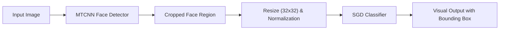

# Face & Gender Detection System with MTCNN & ML
### سیستم تشخیص چهره و جنسیت با MTCNN و الگوریتم‌های یادگیری ماشین

> 🎓 **Academic Note:** This project was developed as a practical assignment for the **Machine Learning & Deep Learning Course** to explore deep face detection models (MTCNN), facial region extraction, and lightweight classification algorithms.

---

## 📌 Project Overview (معرفی پروژه)

تشخیص ویژگی‌های چهره (مانند جنسیت، سن یا احساسات) یکی از حوزه‌های پرکاربرد بینایی ماشین و هوش مصنوعی است. این پروژه یک پایپ‌لاین دومرحله‌ای برای شناسایی چهره در تصویر و سپس طبقه‌بندی جنسیت (مرد/زن) ارائه می‌دهد:

1. **تشخیص و استخراج چهره با MTCNN:**
   - استفاده از شبکه عمیق **Multi-task Cascaded Convolutional Networks (MTCNN)** جهت شناسایی چهره و لندمارک‌های صورت با دقت بالا در زوایای مختلف.
   - برش خودکار محدوده چهره (Crop) و بررسی اعتبارسنجی مختصات جهت جلوگیری از مقادیر منفی.
2. **پیش‌پردازش و طبقه‌بندی جنسیت:**
   - تغییر اندازه تصویر چهره به ابعاد استاندارد `32x32` و نرمال‌سازی مقادیر پیکسل بین ۰ و ۱.
   - آموزش دسته‌بند سریع و بهینه **SGDClassifier (Stochastic Gradient Descent)** برای تفکیک جنسیت.
   - سریال‌سازی و ذخیره مدل با کتابخانه `joblib`.
3. **نمایش بلادرنگ (Inference & Visualization):**
   - رسم کادر احاطه‌کننده (Bounding Box) با رنگ‌های تفکیک‌شده و برچسب‌گذاری مرد (`men`) / زن (`women`) روی تصویر خروجی در OpenCV.

---

## 🏗️ Pipeline Flow (جریان پردازش)



---

## 📂 Project Structure (ساختار فایل‌ها)

```text
face-gender-detection-mtcnn/
│
├── gender_detector_model.py   # اسکریپت استنتاج و تشخیص جنسیت روی تصاویر ورودی
├── training.py                # اسکریپت استخراج چهره‌ها از دیتاست و آموزش مدل
├── test_model/                # مجموعه‌ای از تصاویر تستی جهت ارزیابی کارایی مدل
├── requirements.txt           # کتابخانه‌های مورد نیاز
├── .gitignore                 # فایل‌های نادیده گرفته‌شده توسط گیت
└── README.md                  # مستندات پروژه
```

---

## ⚙️ Installation & Usage (نحوه نصب و اجرا)

### ۱. نصب پیش‌نیازها
```bash
pip install -r requirements.txt
```

### ۲. اجرای تست و تشخیص روی نمونه‌ها
برای ارزیابی مدل روی نمونه‌های تستی موجود در پوشه `test_model/`:
```bash
python gender_detector_model.py
```

### ۳. آموزش مجدد مدل
در صورت داشتن دیتاست کامل، می‌توانید مدل را مجدداً آموزش دهید:
```bash
python training.py
```

---

## 🛠️ Technologies Used (فناوری‌های به‌کار رفته)
- **Python 3.10+**
- **MTCNN (Multi-task Cascaded CNN):** Face Detection
- **OpenCV (cv2):** Image Processing & GUI
- **Scikit-Learn:** SGD Classifier & Model Evaluation
- **Joblib:** Model Persistence & Serialization
